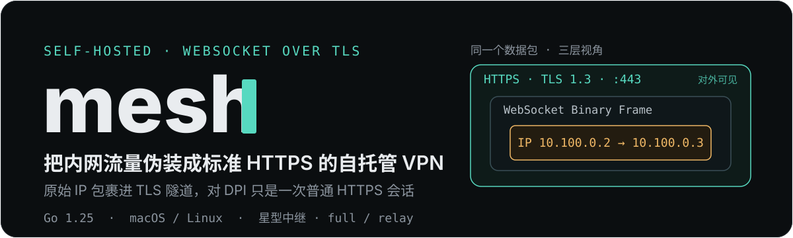
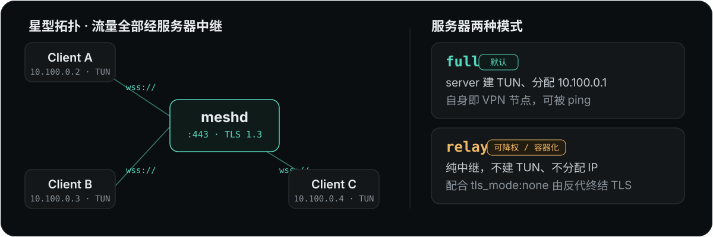
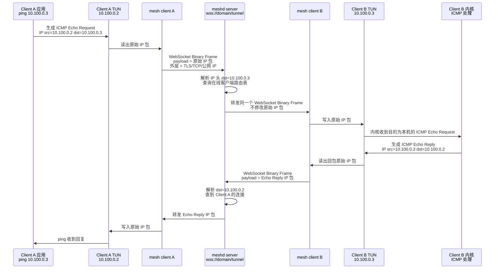

<p align="center">
  
</p>

**mesh** 是一个纯 Go 实现的自托管 VPN。它把你的内网 IP 流量层层封装进 WebSocket over TLS，对外只表现为一次落在 **443 端口的普通 HTTPS 会话**——DPI（深度包检测）看不出这是 VPN。零外部命令依赖，一条 `curl` 完成安装。

- 🕵️ **完全伪装成 HTTPS** — 端口 443、合法 Let's Encrypt 证书、TLS 1.3，链路上与真实网站流量无法区分
- 🧩 **纯 Go，零依赖** — 不调用 `ip` / `wg` / `openssl` 等外部命令，单二进制即可运行
- ⭐ **星型拓扑** — 所有客户端间流量经服务器中继，无需两两打洞
- 🔁 **断线自动重连** — 网络抖动、切换 Wi‑Fi 后隧道自愈
- 🪶 **服务器可降权** — `relay` 模式纯中继、不建 TUN，可容器化并交给反代终结 TLS
- 💻 **跨平台** — 支持 macOS (arm64) 与 Linux (amd64)

---

<p align="center">
  
</p>

mesh 不做 NAT，也不改写源/目的 IP：它只负责把 TUN 设备读到的**原始 IP 包**原封不动地塞进 WebSocket 二进制帧，套上 TLS 送到服务器，服务器解析 IP 头里的目的地址查路由，再把同一个包转发给目标客户端。应用层看到的始终是普通内网通信。

<p align="center">
  
</p>

### 报文如何转发

以 `Client A = 10.100.0.2` ping `Client B = 10.100.0.3` 为例：



报文在不同层看到的形态：

| 位置 | 报文形态 | 说明 |
|------|----------|------|
| Client A 应用/内核 | `ICMP Echo Request` inside `IP(10.100.0.2 → 10.100.0.3)` | 用户执行的普通 `ping` |
| Client A TUN → mesh | 原始 IP 包 | TUN 中读出的就是完整 IP 包 |
| mesh client → server | `WebSocket Binary Frame(payload=原始 IP 包)` inside `TLS/TCP/公网 IP` | 对外表现为标准 HTTPS/WSS 流量 |
| server 内部 | 原始 IP 包 | server 只解析 IP 头里的目的地址做路由决策 |
| server → Client B | `WebSocket Binary Frame(payload=同一个原始 IP 包)` | 不做 NAT，不重写 `src/dst` |
| Client B TUN/内核 | `ICMP Echo Request` inside `IP(10.100.0.2 → 10.100.0.3)` | 内核像收到普通内网包一样处理并生成回包 |

> 若 ping 的目标是服务器自身 `10.100.0.1`（仅 `full` 模式有此 IP），server 发现目的地址等于自己的 TUN IP 后，会把包写入 server TUN 让内核处理；生成的 Echo Reply 再由 server 从 TUN 读出并转发回对应客户端。

---

<p align="center">
  
</p>

最快路径：一条 `curl` 装好服务器，一条 `curl` 装好客户端，注册后即可互 ping。

**1. 服务器**（Linux，需 root，需一个 DNS A 记录已指向本机的域名）

```bash
curl -fsSL https://raw.githubusercontent.com/kvmaker/mesh/master/install.sh | sudo bash -s -- server --domain your.domain.com
```

安装完成后查看注册 Token：

```bash
sudo meshd token show
```

**2. 客户端**（macOS / Linux，需 root）

```bash
curl -fsSL https://raw.githubusercontent.com/kvmaker/mesh/master/install.sh | sudo bash -s -- client
```

**3. 注册并启动隧道**

```bash
mesh join your.domain.com --token <上一步的 Token>   # 注册设备，无需 root
sudo mesh up                                          # 启动隧道，创建 TUN 设备
```

**4. 验证连通**

```bash
ping 10.100.0.1     # ping 服务器（full 模式）
ping 10.100.0.x     # ping 其他客户端
mesh status         # 查看隧道与在线节点
```

**5. 升级到新版本**

重复执行安装命令即为升级：脚本自动覆盖二进制并**重启已运行的服务**（macOS `launchctl kickstart` / Linux `systemctl restart`），设备注册信息（`~/.mesh`）与服务器配置（`/etc/mesh/meshd.yaml`）均不受影响，全程约 10 秒：

```bash
# 客户端升级（macOS / Linux 通用）
curl -fsSL https://raw.githubusercontent.com/kvmaker/mesh/master/install.sh | sudo bash -s -- client

# 服务器升级
curl -fsSL https://raw.githubusercontent.com/kvmaker/mesh/master/install.sh | sudo bash -s -- server --mode relay --domain your.domain.com
```

> 🐢 境内云服务器直连 GitHub 下载 meshd 较慢，服务器升级可改用本地构建：
> `GOOS=linux GOARCH=amd64 go build -ldflags="-s -w" -o meshd ./cmd/meshd`，scp 上去后 `sudo install -m 755 meshd /usr/local/bin/meshd && sudo systemctl restart meshd`。

---

<p align="center">
  
</p>

### 前提条件

- 一台有公网 IP 的 Linux 服务器
- 一个域名，DNS A 记录指向服务器 IP
- 服务器开放端口 **443**（HTTPS）与 **80**（ACME 证书验证）

### relay 模式（降权 / 容器化 / 反代）

若你不希望服务器创建 TUN、持有 `CAP_NET_ADMIN`，或想把 TLS 交给已有的反向代理（如 Caddy）终结，用 `relay` 模式：服务器只做纯中继，默认监听 `127.0.0.1:8443` 并启用 `tls_mode: none`。

```bash
curl -fsSL https://raw.githubusercontent.com/kvmaker/mesh/master/install.sh | sudo bash -s -- server --mode relay --domain your.domain.com
```

多应用共用一台机器、由 Caddy 反代到 meshd 的完整配置见 [`docs/deploy/caddy-multi-app.md`](docs/deploy/caddy-multi-app.md)。

### 卸载

```bash
curl -fsSL https://raw.githubusercontent.com/kvmaker/mesh/master/install.sh | sudo bash -s -- uninstall
```

### macOS 后台服务（launchd）

`sudo mesh up` 默认前台运行。要开机自启、掉线自拉起，注册为 launchd 守护进程：

```bash
sudo tee /Library/LaunchDaemons/com.mesh.vpn.plist > /dev/null << 'EOF'
<?xml version="1.0" encoding="UTF-8"?>
<!DOCTYPE plist PUBLIC "-//Apple//DTD PLIST 1.0//EN" "http://www.apple.com/DTDs/PropertyList-1.0.dtd">
<plist version="1.0">
<dict>
    <key>Label</key>
    <string>com.mesh.vpn</string>
    <key>ProgramArguments</key>
    <array>
        <string>/usr/local/bin/mesh</string>
        <string>up</string>
    </array>
    <key>EnvironmentVariables</key>
    <dict>
        <key>HOME</key>
        <string>/Users/YOUR_USERNAME</string>
    </dict>
    <key>RunAtLoad</key>
    <true/>
    <key>KeepAlive</key>
    <true/>
    <key>StandardOutPath</key>
    <string>/tmp/mesh.log</string>
    <key>StandardErrorPath</key>
    <string>/tmp/mesh.log</string>
</dict>
</plist>
EOF

sudo launchctl load /Library/LaunchDaemons/com.mesh.vpn.plist
```

### 从源码构建

```bash
# 服务器（Linux amd64）
GOOS=linux GOARCH=amd64 go build -o meshd ./cmd/meshd

# 客户端（macOS arm64 / Linux amd64）
GOOS=darwin GOARCH=arm64 go build -o mesh ./cmd/mesh
GOOS=linux  GOARCH=amd64 go build -o mesh ./cmd/mesh
```

或用 Makefile：

```bash
make build-linux    # bin/meshd-linux-amd64 + bin/mesh-linux-amd64
make build-darwin   # bin/mesh-darwin-arm64
```

### 手动部署（不使用安装脚本）

```bash
# 1. 上传二进制
scp meshd user@server:/usr/local/bin/meshd

# 2. 创建配置
sudo mkdir -p /etc/mesh/certs
sudo tee /etc/mesh/meshd.yaml > /dev/null << 'EOF'
domain: "your-domain.com"
listen_addr: ":443"
network: "10.100.0.0/24"
data_dir: "/etc/mesh"
cert_dir: "/etc/mesh/certs"
tun_name: "mesh0"
tun_mtu: 1300
mode: "full"          # full（默认，建 TUN）或 relay（纯中继）
tls_mode: "autocert"  # autocert（Let's Encrypt，默认）或 none（由反代终结 TLS）
EOF

# 3. 初始化（生成密钥与 Token）
sudo meshd init

# 4. 创建 systemd 服务
sudo tee /etc/systemd/system/meshd.service > /dev/null << 'EOF'
[Unit]
Description=Mesh VPN Server
After=network-online.target
Wants=network-online.target

[Service]
Type=simple
ExecStart=/usr/local/bin/meshd run
Restart=always
RestartSec=5
AmbientCapabilities=CAP_NET_ADMIN CAP_NET_RAW CAP_NET_BIND_SERVICE

[Install]
WantedBy=multi-user.target
EOF

# 5. 启动
sudo systemctl daemon-reload
sudo systemctl enable --now meshd
```

---

<p align="center">
  
</p>

### 服务器 `meshd`

```bash
meshd init                     # 初始化（生成密钥和 Token）
meshd run                      # 启动服务
meshd token show               # 查看注册 Token
meshd token reset              # 重新生成 Token
meshd device list              # 列出所有设备
meshd device remove <name|id>  # 移除设备
```

### 客户端 `mesh`

```bash
mesh join <domain> --token <token>  # 注册设备（无需 root）
mesh up                             # 启动隧道（需 sudo）
mesh status                         # 查看隧道状态
mesh peers                          # 查看在线节点
mesh leave                          # 注销并清理
```

### 网络规划

| 角色 | IP |
|------|-----|
| 服务器（仅 full 模式） | `10.100.0.1` |
| 客户端（自动分配） | `10.100.0.2` ~ `10.100.0.254` |

---

<p align="center">
  
</p>

### e2e 测试

基于 Docker 的端到端测试（3 容器：1 server + 2 client），验证连通性、性能与故障恢复。

```bash
bash tests/e2e/run.sh --quick          # 快速模式（连通性 + 性能，约 2-3 分钟）
bash tests/e2e/run.sh --all            # 全量（含故障场景）
bash tests/e2e/run.sh --scenario 01    # 单个场景
STRICT=1 bash tests/e2e/run.sh --quick # 性能硬门槛（release 用）
```

结果输出到 `tests/e2e/results/<timestamp>/`，含各场景 JSON 指标和 `summary.txt`。详见 [`docs/superpowers/specs/2026-07-08-e2e-docker-design.md`](docs/superpowers/specs/2026-07-08-e2e-docker-design.md)。

> macOS 本机若 docker 走 colima，需先 `export DOCKER_HOST=unix://$HOME/.colima/default/docker.sock`；CI（ubuntu-latest）无需。

### 技术栈

| 用途 | 选型 |
|------|------|
| 语言 | Go 1.25+ |
| WebSocket | [`github.com/coder/websocket`](https://github.com/coder/websocket) |
| TUN 设备 | [`golang.zx2c4.com/wireguard/tun`](https://golang.zx2c4.com/wireguard)（仅 TUN 抽象） |
| TLS 证书 | Let's Encrypt via `golang.org/x/crypto/acme/autocert` |
| 数据库 | SQLite via `modernc.org/sqlite` |
| CLI | [`github.com/spf13/cobra`](https://github.com/spf13/cobra) |
